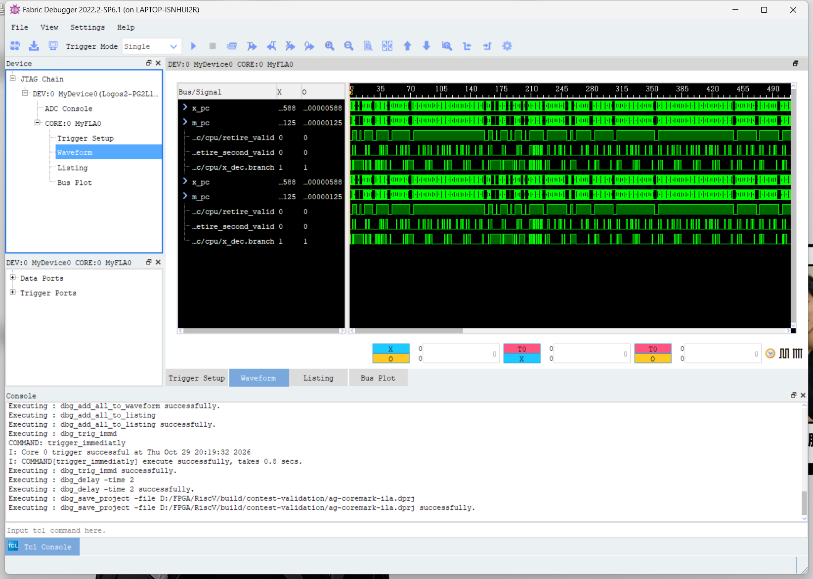
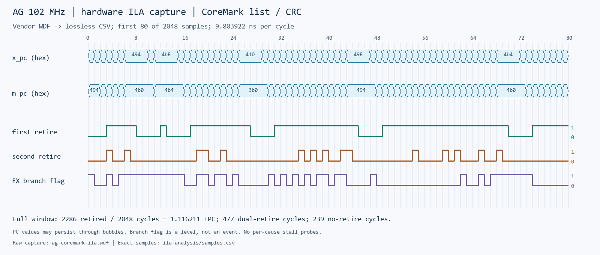

# AG 赛题指标与实板 ILA 记录（2026-10-29）

本目录记录改名后从当前 AG 源码独立生成的工程，不继承旧位流的时序或面积。平台为 MES2L676-100HP / PG2L100H-6IFBG676，PDS 2022.2-SP6.1 build 138931，COM12 / 115200 / 8N1。所有下载仅写 FPGA 易失配置 RAM。

## 三项性能指标

| 项目 | 当前 AG TCM 基准 |
|---|---:|
| 最高已实现闭合且通过板测的频点 | 102 MHz |
| CoreMark 迭代次数 | 6000 |
| 计时周期 | 1,189,859,177（0x46ebcf69） |
| 按标称 PLL 时钟换算时间 | 11.665286049 s |
| CoreMark | 514.346581369 |
| CoreMark/MHz | 5.042613543 |
| 同镜像全 SoC LUT | 7023 |
| CoreMark/LUT | 0.073237446 |
| FF / DRM36K / DSP / GPLL | 2563 / 48 / 4 / 1 |
| 慢角 setup WNS | +0.156 ns |
| 慢角 hold WHS | +0.139 ns |
| 最终多角时序 | All Constraints Met |
| UART 算法结果及随后 JTAG 配置回读 | 均通过 |

计算公式：`CoreMark = 6000 * 102000000 / cycles`，`CoreMark/MHz = 6000 * 1000000 / cycles`，`CoreMark/LUT = CoreMark / 7023`。UART 的整数秒和 `Iterations/Sec=545` 有截断，不能代替上述结果。标称 27 MHz 晶振经 PLL ×34/9 得 102 MHz；未使用外部频率计校准。性能种子 CRC：`e9f5`，list/matrix/state 为 `e714/1fd7/8e3a`。6000 轮满足赛题不低于 10 秒的要求。

本基准使用 64 KiB TCM，未启用 DDR/Cache，LUT 分母为同一个最终布局布线报告的整个 TCM SoC，包含 CPU、UART、GPIO 和存储周边。不能拿这一成绩除以历史 DDR 配置或 ILA 配置的 LUT。完整 DDR/Cache 项目的证据另行记录。

已完成的 108 MHz 对照报告 setup −0.339 ns / 83 个失败端点（Some Constraints Violated）。没有生成或下载此候选位流。用户随后要求不再实现 108 MHz，故不再重跑或优化。102 MHz 是本次已验证最高频点，不声称已经穷举全部 PLL 配置的物理极限。

## 实板 ILA 捕获与流水线分析

独立工程 `build/ag-coremark102-ila` 从相同综合网表插入 DebugCore，102 MHz 最终多角时序闭合，CPU setup +0.313 ns。全 SoC 7655 LUT / 3755 FF / 52 DRM36K；相对本次基准增加 632 LUT、1192 FF、4 DRM36K。该面积独立列出。该 ILA 位流重新下载并运行完整 CoreMark，周期仍为 1,189,859,177，CRC 及随后的 JTAG 回读通过。

使用真实 JTAG 立即触发，取得 65 位 ×2048 点，采样时钟为 CPU 102 MHz，窗口约 20.078431 µs。探针为 EX `x_pc[31:0]`、MEM `m_pc[31:2]`、`retire_valid`、`retire_second_valid`、`x_dec.branch`。综合优化掉的 `m_pc[1:0]` 是零；原工具显示的 `m_pc` 总线为 PC 右移 2 位，CSV 已恢复完整字节地址。例如 GUI 首样点 `x_pc=0x588`、`m_pc=0x125`，CSV 对应 `0x588`、`0x494`。



下面从全部样点 CSV 重绘前 80 周期，PC 为字节地址，原始数据保持不变：



| 原始 2048 周期窗口统计 | 结果 |
|---|---:|
| 至少退休一条的周期 | 1809 |
| 其中双退休周期 | 477（23.2910%） |
| 无退休周期 | 239（11.6699%） |
| 总退休指令数 | 2286 |
| 窗口 IPC | 1.116210938 |
| EX PC 位于 core_bench_list | 1754 点 |
| EX PC 位于 crc16 | 294 点 |

原始 PC 对照相同固件反汇编，捕获窗口覆盖 CoreMark 链表与 CRC 算法。`retire_valid + retire_second_valid` 给出每周期 0/1/2 条退休，证实实际硬件在关键循环中发生双退休。退休有效信号来自 WB 的 `w_valid/w_second_valid`，PC 探针来自 EX/MEM；未采集 WB 退休 PC，不能将同列 EX PC 直接当成该周期退休的指令，也不能精确按函数分配退休数。239 个无退休周期说明仍有气泡或停顿；本次未接专门的 hazard、mispredict、Cache miss 探针，不能把这 239 周期全部归因于数据冲突或分支误预测。`x_dec.branch=1` 共 489 点只是译码标记的电平样本，停顿时可保持，不能当作 489 次实际分支。

这些是一个约 20 µs 的局部窗口，不能代替全程 IPC、分支正确率或 DDR 带宽。矩阵入口精确条件触发尝试被本版本工具的 Tcl 参数校验拒绝，原失败日志保存在 attempts；最终有效捕获为立即触发，不能称为成功的矩阵入口触发。

## 证据与复现

- `tcm102/`：相同源代码、固件、约束、最终时序和 Place & Route 资源、哈希；原始 UART / 配置校验在根目录两个 `ag-coremark102.uart.log*` 文件。
- `ila102/`：独立调试版本时序、资源与输入哈希；`ag-coremark-ila.fic` 为插核配置，`ila-probes.json` 为逐位探针表。
- `ag-coremark-ila.dprj`、`ag-coremark-ila.wdf`：PDS 原始工程与硬件采样数据，可离线打开；`ila-capture3.log` 和 `ila-capture.tcl` 记录实际成功命令。
- `ila-analysis/samples.csv`：从原始 WDF 解码的全部 2048 行，包含原始周期索引、PC、退休和算法符号；`analysis.json` 为统计。
- `coremark-102mhz-6000.dis`、`build-coremark.sh`：相同固件反汇编及实际编译命令。
- `regression/`：改名后的功能回归日志与审计。短 CoreMark 中的持续时间错误是预期的不足十秒提示，不是正式成绩；正式板测另见上述 6000 轮日志。
- `tcm108/` 与 `attempts/`：已经结束的失败候选与工具接口探索，不作为通过证据。

TCM 基准可用当前源码和本目录保存的固件重建（会创建新工程，避免覆盖实测目录）：

```powershell
.\scripts\prepare_board.ps1 -ClockMHz 102 `
  -Firmware docs/results/ag-contest-20261029/tcm102/firmware.hex `
  -OutputDirectory build/ag-tcm102-reproduce -PlacementSeed 0 -HoldMarginPs 200 `
  -RefineRouting -Build -Bitstream
```

本次实际分步执行的 `synth.tcl`、`implement.tcl`、`bitstream.tcl` 在 tcm102 内。重现 ILA 工程时，从该综合网表加入本目录的 FIC、按 `ila102/build.tcl` 独立映射布线；须将 FIC 和 Tcl 内本机绝对路径改成新工程路径，再独立检查最终时序、资源和位流。采集 Tcl 同样需要现有 JTAG 服务、正确的位流/FIC 路径；它会先将该位流下载到 FPGA。跨机器 PDS 路由可能有差异，以重新得到的最终报告为准。

当前最差 setup 路径为 TCM 读数据经 Load 旁路、分支判断/重定向到前端队列 `fetch_count`，11 级逻辑，逻辑 3.395 ns、布线 5.788 ns（63.03%）。这里描述的是实际 STA 路径，不把 ILA 的无退休周期归因于它。完整报告在 `tcm102/ag_board_top.rtr`。

从仓库根目录重新解码：

```powershell
python scripts/analyze_ila_wdf.py docs/results/ag-contest-20261029/ag-coremark-ila.wdf `
  --probes docs/results/ag-contest-20261029/ila-probes.json `
  --disassembly docs/results/ag-contest-20261029/coremark-102mhz-6000.dis `
  --output build/ila-redecode
python scripts/analyze_board_coremark.py docs/results/ag-contest-20261029/ag-coremark102.uart.log `
  --clock-hz 102000000 --luts 7023
```

解码器只接受本次单核 65 通道 / 2048 点格式，检查所有通道恰有一份二进制样本及“第二条退休不得单独出现”的不变量，不猜测其他版本 WDF 格式。解码后首样点与 PDS 显示人工交叉核对一致。原始 WDF 是硬件回读，CSV 和统计为派生分析。

## 当前完整 AG DDR/Cache 重建结果

本轮另建两个 102 MHz 完整 AG SoC 工程：`ag-board-102mhz` 加载 AG Cache 自检固件，`ag-ddr-coremark102` 加载 6000 轮 CoreMark 固件。两者均重新生成 AG DDR IP、编译、综合、映射、布局，并使用 seed 2、多角优化、关闭共享控制链、100 ps hold margin、最多三轮路由优化和 60 分钟实现限时。当前源码的逻辑等价改名审计、DDR/Cache 功能仿真均通过。

- `ag-board-102mhz`：停止时详细路由第 132 次迭代，尚有 3224 条未布通连接。
- `ag-ddr-coremark102`：停止时详细路由第 135 次迭代，尚有 3109 条未布通连接。

本次限时内未取得完整路由数据库与最终时序报告，因此没有生成、下载这些候选位流，也没有新的完整 AG DDR/Cache 正式实板 CoreMark/LUT。结果是**实现未完成**，不能称为已闭合，也不能从中推出 102 MHz 必然不可能闭合。未增加 false path 或放宽真实时钟来绕过该结果；保留原始实现日志、输入与 manifest，后续可以独立继续。

冻结的改名前 102 MHz 完整 DDR/Cache 位流已经通过自检和配置回读，证据在相邻的 `board-ddr-cache-102mhz`；当前 AG 的 TCM 和独立 ILA 位流则已重新实现闭合并通过本次板测。上面三项 TCM 性能指标成立，不能把它们自动当作完整 DDR/Cache SoC 的面积效率。完整 SoC 中 CoreMark 固件仍放在 TCM，即便后续成功运行，也不能据此宣称已测 DDR 带宽或 DDR 中的 CoreMark 性能。

## 赛题边界

基础 RV32I、六级流水冲突控制、UART/GPIO、动态预测与所实现机器态的异常/中断已有回归。两路 I/D Cache 和板载 DDR 的功能证据见相邻 `board-ddr-cache-102mhz` 目录。完整边缘 AI、模型识别率与延迟、传感器/显示融合应用、HTML 渲染、自主 OS、输入与持久化存储仍未实现；不能标记为整套赛题全部验收通过。赛题没有给出固定及格阈值或可自行套用的评分权重。
