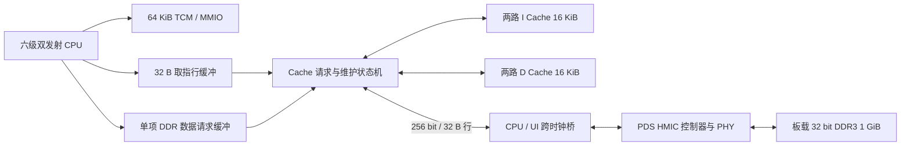

# 两路指令与数据 Cache

2026-10-28～29。赛题一 PDF 物理页 10 的高阶任务要求两路组相联 I/D Cache。本工程此前只有 TCM 和无缓存 DDR；本次实现独立的两路 I Cache 与 D Cache，并保留无缓存开关。

最新完整 SoC 已离线闭合：CPU 102 MHz setup +0.056 ns、slow/fast hold +0.136/+0.099 ns，DDR UI 125 MHz setup +2.216 ns，14618 LUT。见 [最终闭合证据](results/offline-ddr-cache-102mhz/README.md)。本版尚未重新板测。

此前 Cache 实验镜像已通过 102 MHz 配置下的板测和 JTAG 校验，但仍有 setup −0.306 ns，资源 14603 LUT；见 [历史实验板测](results/board-cache-102mhz-experimental/README.md)。新旧版本的板测、时序与资源不能混用。

## 配置与结构

| 项目 | 实现 |
| --- | --- |
| DDR 板级默认容量 | I 16 KiB + D 16 KiB |
| 组织 | 每侧 256 组、每组 2 路、32 字节行，精确两路 LRU |
| 数据策略 | 写回、写分配；支持 CPU 字节与半字使能 |
| DDR 接口 | 每次完整 256 位行读/行写，匹配 HMIC 单拍数据宽度 |
| 快速取指 | 一级 32 字节指令行缓冲，连续双指令取指命中时可连续应答 |
| SRAM | I/D 数据、Tag 和 Valid/Dirty/LRU 元数据均同步读；D Cache 普通读取和维护共用同一读地址 |
| 时序隔离 | DDR 数据请求先进入单项缓冲，CPU ready 不依赖新生成的地址 |
| 容量参数 | 板级 `BOARD_CACHE_SET_BITS=8`，每侧字节数为 `64 × 2^CACHE_SET_BITS`；通用模块默认 7，可按资源调整 |

主要文件为 `rtl/qinglong_l1cache.sv`、`rtl/qinglong_extmem.sv`、`rtl/qinglong_soc.sv`。默认 CACHE_ENABLE 跟随 DDR_ENABLE；TCM 保留直接访问，MMIO 不缓存。`CACHE_ENABLE=0` 可构建无缓存对照。



HMIC 用户侧每个请求为一个 256 bit 数据拍（LEN=0），匹配 DDR3 BL8 的 32 字节数据量；这里没有实现多拍 AXI 突发或多个 outstanding，不能将整行传输写成这些尚未实现的能力。

这是阻塞式行缓存：I/D 有独立的两路存储，后端共享当前单事务仲裁。指令行缓冲提高连续取指吞吐，但跨行与数据请求仍可能停顿；尚未实现多 outstanding、非阻塞 MSHR、DMA 硬件一致性或自动预取。不把存储系统特定测试的加速倍数当作所有程序的提升。

## 器件资源与评分口径

[硬件手册](../教程1_硬件实验指导手册_盘古676系列100Pro开发板.pdf) PDF 第 20 页（印刷页 16）的 PG2L100H-6IFBG676 表格列出：66,600 LUT6、133,200 FF、155 个 36 Kbit 块 RAM；99,900 是等效 LUT4 数，不能直接当成 LUT6 数。19,175 LUT6 约占器件 28.8%，容量上可容纳，但面积仍影响比赛得分。[赛题](../紫光.pdf) PDF 第 11 页明确列出 CoreMark/MHz、满足时序的最高频率和 CoreMark/LUTs 三项指标，没有提供三项的权重，也没有明确 LUT 分母中外设的扣除规则。交付应同时保留整机与模块资源，不自行排除 DDR、Cache 等模块来提高数字。

[通用手册](../教程2_通用实验指导手册_盘古676系列100Pro开发板.pdf) PDF 第 68 页介绍了分布式 RAM 与 DRM RAM 的资源差别；[教材配套手册](../教程4_《国产FPGA权威开发指南》教材配套实验指导手册_盘古676系列100Pro开发板.pdf) PDF 第 38 页介绍了 CLMS 分布式 RAM。Cache 数据和 Tag 已映射到 DRM；小型元数据可按工具映射使用少量分布式 RAM。关键是核对实际推断结果，避免大数组复制或大量可复位寄存器与动态索引译码。

本轮面积优化保持 I/D 各 16 KiB 和原命中时序：将 Valid/Dirty/LRU 位图改为同步元数据 RAM，复位后逐组初始化（256 拍），并合并 D Cache 的普通读取与维护扫描地址，消除重复 RAM 副本。初始化只阻止 DDR 缓存访问，不阻止 TCM 启动；维护仍逐组处理，不增加命中延迟。

| 同一阶段比较 | 优化前 | 优化后 |
| --- | ---: | ---: |
| Cache 模块综合 LUT | 5,844 | 1,764（−69.8%） |
| Cache 模块综合 FF | 3,411 | 816 |
| Cache 模块 DRM36K 等效数 | 27 | 18.5 |
| 整机器件映射 LUT | 19,007 | 14,664（−22.8%） |
| 整机器件映射 FF | 13,058 | 10,464 |
| 整机器件映射 DRM36K 等效数 | 75 | 66.5 |
| 整机最终布线 LUT | 18,894 | 14,541（−23.0%） |
| 整机最终布线 FF | 13,058 | 10,467 |

18 Kbit DRM 按半个 36 Kbit 等效块计数，因此报告允许出现 .5；这不是物理器件数量。综合模块数据来自 `.snr`，整机映射数据来自 `.dmr`，最终布线数据来自 `.prr`，每一行按相同阶段比较。优化前工程为 `ddr-soc102-cache16-redirect`，优化后映射工程为 `ddr-soc102-cache16-area`，最终实现工程为 `ddr-soc102-cache16-compact`。缓存模块面积明显下降，完整自检周期和 DDR 事务数保持不变。原始报告及精确输入快照见 [面积优化证据](results/cache-area/README.md)。

CoreMark 现有正式板测运行在 TCM，Cache 不会加速这段 TCM 程序。该成绩对应的旧 TCM 工程资源为 7,089 LUT，不能直接除以新 Cache 工程 LUT 后宣称实测资源效率。Cache 版正式 CoreMark/LUT 必须使用同一固件、配置、实际主频和最终资源报告重新测量，且运行至少 10 秒。

## 一致性和错误处理

CPU 的 FENCE.I 发出维护脉冲：先排空已接受的事务、写回所有 D 脏行，再无效化 I/D 缓存及取指行缓冲。维护阻止新的 CPU 缓存请求，维护写回继续访问 DDR。维护脉冲在内部登记为 pending，避免把 CPU 的晚到控制信号接入缓存 ready 关键路径；脉冲同周期已接受的事务先完成。旧的错误路径取指仍按 CPU 原有 flush/kill 机制丢弃，维护完成前后续 DDR 指令不会从旧的行缓冲取数。

填充失败不安装新行；替换写回失败保留原来的有效脏行，向当前 CPU 请求报告错误；维护写回失败锁存错误标志，随后缓存请求报错，直到系统复位，避免执行未完成同步的代码。TCM 中的诊断程序仍可访问状态寄存器。写回完成表示控制器按原接口接受该行，不是持久化到非易失存储。外部 DMA 不会自动窥探 Cache：DMA 前后必须显式维护并等待完成。

取指与数据各有独立响应槽：取指响应因前端队列满而等待时，数据请求仍能完成，避免“CPU 等待 store、前端等待 CPU、store 等待取指响应”的环形等待。两个端口均有请求时按轮转优先级仲裁。

| MMIO 地址 | 功能 |
| --- | --- |
| 0x10000200 | bit 0 DDR ready、bit 1 DDR fault、bit 2 DDR 已集成、bit 3 Cache busy、bit 4 Cache 维护错误、bit 5 Cache 已启用 |
| 0x10000204 | 写 bit 0=1 启动写回并无效化；读 bit 0 busy、bit 1 维护错误 |
| 0x10000210 / 14 | I 行 Cache 命中 / 未命中次数 |
| 0x10000218 / 1c | D 行 Cache 命中 / 未命中次数 |
| 0x10000220 | 成功的脏行写回次数 |
| 0x10000224 | 指令行缓冲命中次数 |

软件维护：写 0x10000204=1，再轮询 bit 0 直到清零，并检查 bit 1。DMA 读取 CPU 写入的数据前需要维护；DMA 写内存前维护，DMA 完成后再次维护/无效化，期间 CPU 不得写相同缓存区域。普通 FENCE 不等同于本平台的非一致性 DMA 缓存维护。

## 已验证性能

同一固件、同一 DDR 仿真模型、每侧 16 KiB：热身 DDR 代码循环从 21325 降到 4336 周期，约 4.91 倍；完整自检从 166067 降到 96006 周期，约 1.73 倍；DDR 事务从 10570 降到 1232，减少约 88.3%。完整自检包含 16 次修改已取指代码并执行 FENCE.I。缓存版本另外检查维护 MMIO 和计数器，计时循环本身相同。这是 RTL 仿真，尚无缓存版本实板 CoreMark 或频率成绩。原始记录见 [Cache 仿真归档](results/cache-simulation/README.md)。

CPU 关键路径优化后，219 组随机背压差分检查通过；短程 CoreMark 10 次迭代为 1,983,373 个测量周期，算法 CRC 正确，吞吐等效 5.041916 CoreMark/MHz。该程序运行于 TCM，仅用于确认 CPU 优化未损失周期性能，不能作为 DDR Cache 的 CoreMark 成绩。

历史完整 Cache 实现为 19,175 LUT、13,030 FF、75 DRM36K、4 DSP、3 GPLL；CPU 102 MHz setup −0.571 ns，DDR UI 125 MHz +1.188 ns，尚未闭合。随后的重定向修订 `cache16-redirect` 为 CPU −0.932 ns、94 个违例端点，DDR UI +0.775 ns。精简元数据与 RAM 端口的 `cache16-compact` 最终为 14,541 LUT、10,467 FF、66.5 DRM36K 等效、4 DSP、3 GPLL、2 PPLL；CPU 102 MHz setup −0.918 ns（164 个端点），DDR UI +0.345 ns，两个角的 hold 通过，未生成正常位流。不能将历史 TCM 的闭合或板测结果当成 Cache 版的最终结果。

该阶段的最差路径为 `fetch_insn → 配对依赖检查 → fetch_pop → FIFO 搬移`，不是 Cache 命中数据通路。环形队列候选 `cache16-ring` 功能通过、映射为 14,581 LUT，但初次及一次布线重试均卡在两条连接，已停止；没有最终时序或可用位流，不采用为当前实现。

随后 `cache16-prepair` 保留已成功布线的压缩队列，在入队时登记寄存器匹配、与前项的 PC 相邻关系、预测是否顺序执行；这些元数据跟随指令移动。配对判断读取已寄存标志，减少当拍宽比较和地址加法。219 轮差分、异常/中断、Cache 自检与短 CoreMark 均通过，所有测量周期不变；映射 14,840 LUT，比精简基线多 176 LUT（约 1.2%），需以最终时序判断收益。完整实现限时 20 分钟，拥塞回退迭代上限 40，并保存拥塞诊断。

拥塞诊断进一步定位到 MULH 高位乘法 DSP 的 CEM/CEP 使能，两条使能由同一个 LUT6D 的两路输出产生。关闭共享控制链后仍未解决这两条连接，因此 `cache16-dspfree` 将可选 MULH 流水的数据寄存器改为连续采样，原 ready 标志决定何时观察结果；通用 MULH_PIPELINE=0 路径保持原逻辑。差分与短 CoreMark 通过，周期未变，新增固件的 12 次高位乘法边界检查也通过。综合网表已确认 CEM/CEP 接常量 1；该版映射 14,709 LUT，最终实现 14,603 LUT、10,480 FF、66.5 DRM36K 等效；102 MHz 初次路由 setup −0.642 ns。继续路由后的最佳结果为 −0.306 ns，34 个违例端点；该结果完成了实验性实板 Cache 自检，但仍未静态闭合。完整记录见 [Cache 实板实验归档](results/board-cache-102mhz-experimental/README.md)。

## 102 MHz 时序闭合进度（2026-10-29）

所有候选均保持 CPU 102 MHz、DDR UI 125 MHz、两路 I/D Cache 每侧 16 KiB。没有为消除违例增加功能路径 false path、multicycle 或放宽时钟。该阶段 CPU setup 最佳 −0.306 ns，慢角/快角 hold 分别 +0.081/+0.052 ns；DDR UI setup +1.357 ns，其他时钟、跨域受约束路径、恢复/移除及脉宽检查通过。上述结果来自 `build/ddr-soc102-cache16-refine/place_route/route_constraint_ite_2`，不是最新 RTL 的闭合证明。

继续累积关键网络布线优先级的候选 `cache16-priority` 为 −0.493 ns、20 个违例端点，不能代替最佳结果。其最差路径约 70% 延迟来自布线。当前正比较 CPU 局部布局与路由收敛策略；局部布局使用 PDS 的 floorplan 坐标，限定 CLMA/CLMS，保留 DSP 和 DRM 的自动布局。已检查器件映射输出，`def_region` 和 CPU 叶节点的 `def_inst_region` 确实生成，不能仅凭 FDC 被读取就认定约束生效。

最新 RTL 的 IF2 轻量元数据译码、MIN/MAX 移到已有 MEM 级、预测顺序标志提前计算、Cache 写命中在原响应拍提交等修改已通过差分、异常/中断和 Cache 自检；映射为 14,387 LUT。详细布线未完成的候选没有最终资源/频率成绩，不能发布为通过时序的位流。当前实板仍是归档中的实验性镜像。

## 构建与上板

```powershell
wsl -d Ubuntu-24.04 -- bash -lc 'cd /mnt/d/FPGA/RiscV && make cache-test'
.\scripts\prepare_ddr_board.ps1 -OutputDirectory build\ddr-cache-board `
  -Firmware build\cache_smoke.hex -MulhPipeline -CacheSetBits 8 -Build -Bitstream
```

上述命令使用当前源码生成 `build/ddr-cache-board/qinglong_board.pds`，可直接在 PDS 打开，包含全部 RTL、DDR IP 和约束；历史候选目录用于保存各自结果。使用 `-NoCache` 可生成无缓存对照；使用 `-Build -MapOnly` 可只做综合与器件映射以比较面积，不能生成位流。完整实现应执行上面的完整命令，在同一流程中完成 DDR IP 的打包和物理约束处理。PDS 整机实现与最终时序需独立检查；不能继承无缓存工程的资源、时序或实验板测。

整体通过时序后，下载命令：

```powershell
.\scripts\program_board.ps1 -Port COM12 -Profile build\ddr-cache-board `
  -Output build\ddr-cache-board\board-uart.log `
  -Expected 'CACHE PASS DDR code warm-hit self-modify maintenance\r?\n'
```

缓存自检固件先打印 DDR PASS，再执行代码热身、自修改和维护检查，因此必须等待最终的 CACHE PASS 后再做 JTAG 校验。默认构建脚本会阻止未通过时序的镜像作为正常配置下载。

## 2026-10-29 当前闭合结果

上面的负裕量记录均为历史候选。将旋转、CLZ/CTZ/CPOP 移到已有 MEM 级，保持完整 Load 旁路；种子 2 + 多工艺角优化 + 优先布线第 2 轮获得 `All Constraints Met`：CPU 102 MHz setup +0.056 ns，slow/fast hold +0.136/+0.099 ns；DDR UI 125 MHz setup +2.216 ns，其他受约束路径检查通过。资源 14618 LUT、10521 FF、66.5 DRM36K 等效、4 DSP、3 GPLL、2 PPLL。

短 CoreMark 保持 1983373 周期、等效 5.041916/MHz；完整 Cache SoC 自检保持 96006 周期、1232 次外部事务、热代码 4336 周期。本轮未连接 FPGA，不能把离线时序与仿真作为本版板测成绩。最终证据见 `results/offline-ddr-cache-102mhz` 与 `results/rv-late-alu-simulation`。
