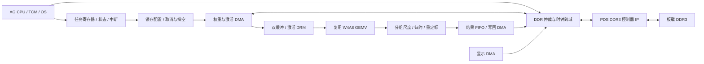

# 模型加速器整合与 AI 浏览器方案

审查日期：2026-10-25。对象为 [Tigrisz/LLM-Accelerator](https://github.com/Tigrisz/LLM-Accelerator)，固定提交 `cd06ae6e9d820bca3bb5d22b8eaf91e32dec43ec`。本工程修改前已执行 `git pull --ff-only --no-recurse-submodules`，返回 Already up to date。

**结论：可以复用其 W4A8 GEMV 核心；目前的顶层是预加载数据的验证系统，还不是可直接接入AG CPU 的完整推理设备。** 第一阶段应用确定为“输入网址 → 模型猜测网站主题 → 生成 HTML → 本地显示”。模型未定，下面的候选和参数是待实测方案。DDR 控制器按用户要求采用 PDS 自带 IP，接板载 DDR3。

## 1. 已经有什么，缺什么

| 部分 | 仓库现状 | 整合判断 |
| --- | --- | --- |
| 计算 | 16/32 路有符号 INT4 权重 × INT8 激活，INT32 分组部分和 | 可复用，有独立 golden 与背压测试 |
| 数据格式 | 每组 128 元素，权重按行/组排列，低半字节在前 | 先固定此格式，模型导出器必须匹配 |
| 控制 | 寄存器、任务控制器、激活缓存、权重 reader | 可改造，不宜直接暴露给软件 |
| 内存 | 顶层实例化 64 KiB 抽象 `memory_model`，host 预加载 | 需要换成外部内存接口；不是 DDR 控制器 |
| 输出 | `(row_id, group_id, partial_sum)` 流 | 缺 CPU 可读结果队列、DMA/中断及反量化尾处理 |
| 模型 | Qwen2.5-1.5B 的一个层、一个 token、16 行切片 | 证明切片计算，尚未证明逐 token 完整推理 |
| 应用 | 无 tokenizer、完整 Transformer、HTML 生成/显示 | 需要 CPU 运行时和应用层共同完成 |

`activation_base` 目前只是预留配置，没有从该地址加载激活的 DMA。不能只接几个 MMIO 寄存器就认为 CPU 已经可以提交模型任务。依据：[accelerator_control_top.sv](https://github.com/Tigrisz/LLM-Accelerator/blob/cd06ae6e9d820bca3bb5d22b8eaf91e32dec43ec/rtl/control/accelerator_control_top.sv#L72)。

仓库归档的固定 ROM/UART 工程在 27 MHz 下完成过板端切片校验；它不是动态控制顶层。其资源和时序不能直接套用到“CPU + DDR + 动态加速器 + 显示”的新 SoC。

## 2. 整合前优先修改

### P0：任务配置与恢复协议

1. **START 时锁存完整任务描述符。** 当前 N、K、地址继续引用软件配置寄存器。审查探针复现：N=2 的任务运行中改写 N=1，只接收一个结果就报告 DONE。建议 shadow 配置与 active 配置分离；一次 start 只复制一次，运行期间只读取 active；激活缓存正在使用的 bank 也不能被 host 重载。依据：[task_controller.sv](https://github.com/Tigrisz/LLM-Accelerator/blob/cd06ae6e9d820bca3bb5d22b8eaf91e32dec43ec/rtl/control/task_controller.sv#L53)。
2. **增加局部复位/取消与排空状态。** `weight_reader` 进入 S_ERROR 后只能复位恢复；清 task 状态并重新 start 不会恢复 reader。真实 DDR 若仍有已接受请求，必须先排空返回数据或按事务代号丢弃，不能把旧返回接到新任务。完成条件应是所有结果已提交、相关请求已排空。依据：[weight_reader.sv](https://github.com/Tigrisz/LLM-Accelerator/blob/cd06ae6e9d820bca3bb5d22b8eaf91e32dec43ec/rtl/memory/weight_reader.sv#L134)。
3. **明确字节写语义。** 当前 `bus_wstrb != 0` 就覆盖整个寄存器，CTRL 命令也不按 byte 0 使能过滤。这是现有简化接口的行为，不能当标准 AXI byte strobe 使用。可选择实现逐字节合并，或在 CPU 桥中明确拒绝非对齐/非 32 位写；不能让 `sb/sh` 静默改变其他字节。依据：[control_regs.sv](https://github.com/Tigrisz/LLM-Accelerator/blob/cd06ae6e9d820bca3bb5d22b8eaf91e32dec43ec/rtl/control/control_regs.sv#L81)。

这三点有可运行复现探针：[accelerator_v1_contract_probe.sv](../tests/accelerator_v1_contract_probe.sv)。它刻意检查当前版本的限制，修复后的版本不应继续以这个探针的 PASS 作为正确性标准，届时应改成验证新契约。

### P0：分组尺度、维度与模型运算

硬件当前输出的是整数部分和，正确计算是：

```text
P[n,g] = sum_i(qw[n,g,i] * qx[g,i])
y[n]   = sx * sum_g(sw[n,g] * P[n,g]) + bias[n]
```

上述 `sx` 对应当前仓库的整向量激活尺度；如果以后改成逐组激活尺度，应把 `sx[g]` 也放进求和。**不同组的 `sw` 不同，不能先把全部 INT32 部分和相加，再乘一个权重尺度。** 尾组补零、零向量尺度、舍入/饱和、尺度数据类型都要进入文件格式版本。

- N 是 16 位。Qwen 的 151936 行词表投影不能一次提交；使用 N 分块并保留全局行偏移，或扩宽 ID/计数/接口。建议先用固定大小 tile，避免控制规模膨胀。
- 默认激活缓存 K≤8192；Qwen2.5-1.5B 的 FFN down projection 输入宽度为 8960，需 K 分块或扩容。K 分块边界必须与量化分组一致。
- 不能只有线性层。完整解码仍需 embedding、RMSNorm、RoPE、attention/KV cache、softmax、SiLU、残差、bias、tokenizer、采样。Qwen3 的结构不能只换层数参数套到 Qwen2 上。
- AG CPU 没有 F 扩展。软件浮点可以先做正确性参考，但不应作为高吞吐最终实现的默认假设。优先给加速器补尺度乘法/组归约/重定标，再量测其余算子的占比。

例如 0.5B 的词表投影 K=896，即每行 7 组；151936 行会产生 **1,063,552 个 INT32 部分和，约 4.06 MiB/token**，尚未计标签。逐个通过 MMIO 交给 CPU 做浮点尺度乘法会很昂贵。应在硬件尾处理归约为每行一个结果，最终可加 argmax/top-k，减少 CPU 读回与扫描开销。

### P1：先供数，再加 MAC

仓库的确定性仿真中，N=8、K=2048、抽象内存 LATENCY=2 时，16/32 路分别用 2048/1536 周期，即 8/10.667 MAC/cycle；LATENCY=20 时分别为 3.765/4.267 MAC/cycle。并行度翻倍只获得约 1.333/1.133 倍吞吐。这是其抽象内存模型结果，不是真实 DDR 带宽。依据：[lane_benchmark](https://github.com/Tigrisz/LLM-Accelerator/blob/cd06ae6e9d820bca3bb5d22b8eaf91e32dec43ec/docs/lane_benchmark_2026-10-19.md)。

优先改动：

1. 每组 64 B 请求改成连续长突发预取；以 256–1024 B 为初始实验范围，遵守实际 IP 的 burst、边界和队列限制。双缓冲重叠读取与计算。
2. 把 `base + row * stride + group * 64` 的实时地址乘法改成锁存的行基址/递增地址。
3. 激活缓存改成明确的同步宽字 DRM 存储，配弹性输出寄存器；双 bank 的 load/use 所有权必须独立。现有按字节数组组合读 32 字节的写法，不能在没有综合报告时声称已映射到理想块 RAM。
4. 分级流水乘法/加法树，保持 valid/ready 背压一致。32 路乘积归约和 128 元素组累加可评估更窄内部位宽：完整有符号 W4A8 的单乘积 12 位、32 路和 17 位、128 路和 19 位足够，输出仍扩展至 INT32。是否节省 LUT 以 PDS 实现报告为准。
5. 同时记录有效 MAC/cycle、reader 等待、输出背压、实测 DDR B/s、LUT/DSP/DRM、整机功耗与 token/s；不只报理论 TOPS。

32 路假设运行在 100 MHz，理想上限为 3.2 GMAC/s；若一个 token 约需 0.5 G MAC，单计算下限已约 0.156 s/token，256 token 至少约 40 s。这只是数量级算术，不是板端预测；访存、prefill、非矩阵算子还会增加时间。因此浏览器应生成短页面，先有可用结果再讨论加宽。

## 3. 接入AG SoC



接口草案：加速器 MMIO 独占 `0x10004000–0x10004FFF`；DDR 窗口沿用 OS 规划的 `0x80000000–0xBFFFFFFF`。这两个新映射必须以实际 RTL 和驱动提交为准，不能从设计图推断已经存在。

- CPU 原总线是自定义请求/响应握手。桥接需要保存请求、只产生一次寄存器写/START、副作用完成后返回响应，并保持响应直到 CPU 接收；不能把 always-ready 组合寄存器直接连上。
- 先完成 CPU 可读结果 FIFO 的小矩阵链路，再换 DMA/硬件尾处理。队列满时向计算核背压；完成中断用保持到软件清除的状态，防止丢脉冲。
- 加速器不包含 DDR PHY。将 `memory_model` 移到 testbench，生产顶层导出真正读请求/返回端口，接 PDS IP 的用户接口桥。
- DDR 用户时钟、CPU 时钟、显示时钟独立设计。跨域使用经过验证的异步 FIFO/握手，复位按各域同步释放，校准完成之前禁止向 DDR 发访问。
- 第一阶段 DMA 区不缓存；后续若有 Cache，要补一致性维护。CPU 的 FENCE 不能代替不存在的 Cache clean/invalidate。
- 整机重新综合和时序分析。当前 CPU-only 最小 SoC 的 102 MHz 闭合，不代表增加 DDR 和加速器后仍然闭合；现有已闭合归档独立保留。

模型包不要绑定一个固定 ROM。清单至少记录：模型 revision/文件哈希、张量名、逻辑 N/K、物理填充 K、row stride、group size、权重打包顺序、量化算法版本、尺度类型/位置、bias、tokenizer/chat template、层数、Q/KV 头数、**显式 head_dim**、最大上下文。CPU 检查格式与硬件能力后才能运行。

## 4. 模型候选与内存预算

这不是已经跑完的质量排名。优先测试 **Qwen2.5-0.5B-Instruct**，因为已有 Qwen2.5 导出参考、维度适合现有缓存且 KV 较小；Qwen3-0.6B 作能力对照；SmolLM2-360M 作更小容量的对照。1.5B 暂留为质量参考，不能因 16 行切片成功就直接确定整机部署它。

| 候选 | 层数 / hidden / FFN | KV heads × head_dim | 1024 token、FP16 KV | 全权重按 4 bit 的粗略容量* |
| --- | --- | --- | ---: | ---: |
| Qwen2.5-0.5B-Instruct | 24 / 896 / 4864 | 2 × 64 | 12 MiB | 约 0.25 GB |
| Qwen3-0.6B | 28 / 1024 / 3072 | 8 × 128 | 112 MiB | 约 0.30 GB |
| SmolLM2-360M-Instruct | 32 / 960 / 2560 | 5 × 64 | 40 MiB | 约 0.18 GB |
| Qwen2.5-1.5B-Instruct | 28 / 1536 / 8960 | 2 × 128 | 28 MiB | 约 0.77 GB |

\* GB 为十进制，MiB 为二进制。这里只是参数存储算术，未计尺度、未量化张量、padding、tokenizer、激活工作区、OS/帧缓冲；实际文件大小必须由导出清单求和。不能把当前切片格式等同于任意 GGUF/GPTQ/AWQ 文件。权重按组 128、FP32 scale 时尺度额外约为每参数 1/32 字节；若改 FP16 scale，还要验证精度与硬件支持。SmolLM 的 K=960 在当前分组下需填到 1024。

KV 计算公式为 `2 × layers × context × kv_heads × head_dim × bytes`。尤其 Qwen3-0.6B 的 `head_dim=128` 是配置显式值，不能用 `hidden_size / num_attention_heads = 64` 替代。Qwen3 首测关闭 thinking，以免将有限生成预算耗在思考文本。

依据官方配置：[Qwen2.5-0.5B](https://huggingface.co/Qwen/Qwen2.5-0.5B-Instruct/raw/main/config.json)、[Qwen3-0.6B](https://huggingface.co/Qwen/Qwen3-0.6B/raw/main/config.json)、[SmolLM2-360M](https://huggingface.co/HuggingFaceTB/SmolLM2-360M-Instruct/blob/main/config.json)、[Qwen2.5-1.5B](https://huggingface.co/Qwen/Qwen2.5-1.5B-Instruct/raw/main/config.json)。非思考开关见 [Qwen3 模型卡](https://huggingface.co/Qwen/Qwen3-0.6B)。正式导出时固定 revision，不能依赖可变 main。

建议第一轮参数：group=128、W4A8、16/32 路均保留，context=1024，输入最多 512 token，输出先测 128/256 token，batch=1。首次对比使用固定解码配置及随机种子；最终采样策略由页面质量决定。先在 PC 使用**同一种量化算法**进行完整自回归对比，再投入 FPGA 算子优化。PC 实验只是选型验证，不算板上推理。

现有浮点切片报告中，相对 L2 约 **9.71%**、最大逐行相对误差约 **63.79%**、余弦约 **0.99549**。对象只有一个 prompt/token 的 16 行，且量化前权重/激活来自 BF16，不是全模型 FP32 基线。不能只凭余弦相似度认定 HTML 生成质量合格。见[原始浮点参考报告](https://github.com/Tigrisz/LLM-Accelerator/blob/cd06ae6e9d820bca3bb5d22b8eaf91e32dec43ec/docs/qwen_float_reference_2026-10-22.md)。

## 5. 浏览器第一版的完整行为

用户输入 URL，CPU 将 URL 作为数据送入固定提示，模型推断主题并生成一小段 HTML。系统固定显示地址栏、返回/前进、生成进度，以及“AI 想象页面”标记；页面内容不冒充实时抓取结果。第一版不依赖 DNS、HTTP、TLS 或联网模块。

```text
输入 URL → 检查长度/编码 → 创建 request_id → tokenizer → 模型生成
        → HTML 子集检查 → 构造有界节点树 → CPU 绘图 → HDMI
点击生成页面内的链接 → 解析目标 URL → 再发一次生成请求
```

- **HTML 是模型输出，外层窗口由系统提供。** v0 只接受一个 `<main>` 根，标签限定 main/h1/h2/p/div/span/ul/li/a/br；只允许 a 的 href 属性。固定字体/间距/颜色，不要求模型输出 CSS、JS、图片或整个网页工程。
- 首测目标每页 8–32 个节点、1–2 KiB 文本；解析硬上限可先定 16 KiB、64 节点、深度 8。输出 token 达上限但标签未闭合应判失败，不能自动执行半页残片。
- URL 最多 256 字节 UTF-8，经统一规范化后作为 JSON 字段传入；URL 中的 query、路径文字和指令样式文本始终是数据。输出不允许 script、事件属性、外部资源加载或任意本机命令。
- 模型 token 流只进入临时缓冲；完整通过检查后原子替换当前页面。生成中可取消、换网址，旧请求完成时按 request_id 丢弃，不覆盖新页面。
- 后退/前进优先恢复保存的页面，不重跑模型；同 URL 的缓存键还包含模型版本、提示版本和生成参数。
- 本版不要求 QApp 事件脚本、应用商店和计算器。保留原 OS 总体设计作为后续扩展，避免第一版被通用应用运行时拖慢。

提示模板和首批 URL 用例见 [browser-v0/prompt.md](browser-v0/prompt.md)、[cases.jsonl](browser-v0/cases.jsonl)。这些是人工编写的测试材料，**不是模型已经生成的结果**。

选型报告至少给出：原始输出 HTML 合法率、主题匹配率、中文可读性、输出截断率、非支持标签率、首 token 延迟、端到端时间、峰值内存、平均输出 token 数。语法成功与内容质量分别计数；同一套用例比较浮点模型和完整 W4A8 模型。正式验收集建议扩展到至少 100 条，并与量化校准/微调样本分离。

## 6. 本次验证及分阶段验收

本地已重跑上游 `test-compute test-system-control test-integration test-integration16`：16/32 路核心各 139 个用例、16/32 路集成各 107 组 fixture；Python 测试显示 `Ran 87 tests, OK (skipped=5)`，其中 5 个 Windows/PDS 入口测试在 WSL 跳过。独立审查探针又复现了三项接口限制。未声称重跑全部 24 阶段回归，也没有新上板或完整模型运行。

复现证据见 [results/accelerator-review](results/accelerator-review/README.md)。本次没有修改或推送队伍加速器仓库。

| 阶段 | 交付与验收 |
| --- | --- |
| A：板载内存 | PDS DDR3 IP、真实引脚/时钟约束、校准状态、CPU 读写桥；离线仿真后上板地址/字节写/随机压力测试 |
| B：动态矩阵 | 锁存描述符、错误恢复、输出队列；CPU 加载不同 W/A，经 DDR 完成多组 GEMV，与独立参考逐项一致 |
| C：量化层 | 接入 scales/bias/重定标；至少覆盖 attention/FFN/词表投影与边界 tile，多 prompt/token 对比浮点 |
| D：完整模型 | tokenizer、完整解码、KV cache、取消和内存上限；先产生可重复的短 HTML 文本 |
| E：浏览器 | 键盘地址栏、HTML 子集解析、帧缓冲/HDMI、历史缓存；运行完整 URL 验收集并报告实际等待时间 |

下一轮性能优化应由 B–E 的实测瓶颈决定。CPU 的 CoreMark/MHz、AI 的 MAC/cycle 和浏览器的可用页面生成时间是三个不同指标，需要分别报告。
