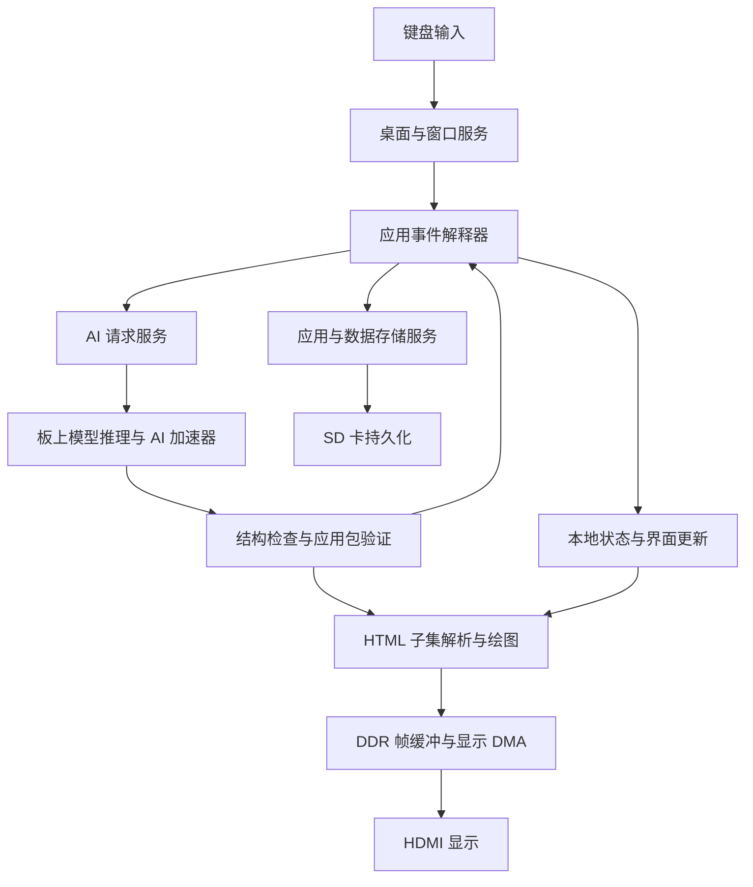
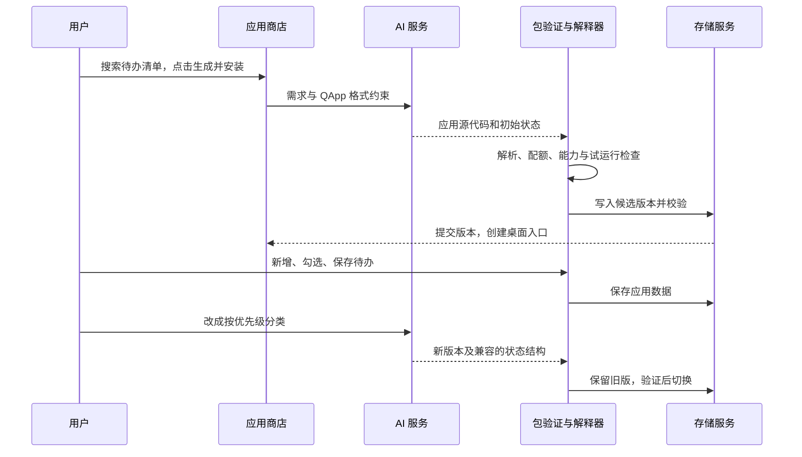

# 青龙 OS：面向 FPGA 的 AI 即时应用系统

设计日期：2026-10-23；范围更新：2026-10-26。**OS、图形界面与模型推理仍是设计方案。当前唯一确定的首发应用是 AI 浏览器：输入网址，由模型猜测主题生成 HTML，本地受限渲染。** 下面计算器和应用商店保留为后续扩展。模型与参数尚未确定，见[模型加速器整合与浏览器方案](模型加速器整合与浏览器方案.md)。DDR 已推进至独立 IP 和 SoC 接口实现，最新验证状态见[板载 DDR3 接入与验证](板载DDR3接入与验证.md)；CPU 成绩以[性能与验证报告](性能与验证报告.md)为准。

## 1. 要做出的效果

用户用自然语言提出需求，系统生成能操作的应用；操作可以再次调用 AI，结果更新在应用窗口中。应用可以保存、重新打开，也可以继续通过对话修改。

| 场景 | 用户操作 | AI 做什么 | OS 与 CPU 做什么 |
| --- | --- | --- | --- |
| AI 计算器 | 输入 `1+1=`，按等号 | 接收完整表达式，返回答案 `2` | 处理按键、发送请求、显示答案、保存历史 |
| AI 浏览器 | 输入网站名、网址或主题，按打开 | 生成对应的简化 HTML 页面；点击链接后可生成下一页 | 渲染页面、处理表单和链接、维护前进后退历史 |
| 生成式应用商店 | 搜索“待办清单”，点击生成并安装 | 生成应用界面、事件脚本和初始数据；后续按对话修改 | 检查应用包、执行脚本、安装版本、保存数据和回滚 |

参考用户提供的 [benis-me/VibeOS](https://github.com/benis-me/VibeOS)：借鉴其操作驱动界面生成、应用保存和版本修改的体验。原项目是浏览器前端与服务端构成的系统；这里重新设计裸机内核、绘图和应用运行时，不移植其浏览器技术栈。

暂定产品名“青龙 OS”。桌面、任务栏、窗口边框和系统对话框是固定组件，模型只生成窗口内的应用。第一版允许两个可见窗口、最多四个打开的应用；固定主题，先做好键盘操作，不把复杂动画、多代理后台活动、整套浏览器引擎作为前提。

“即时”指生成后就能运行，**不预设模型能在一秒内完成生成**。模型能力、首 token 延迟和生成速度必须在选定模型、量化方案及 DDR/加速器完成后实测。

## 2. 两种应用行为共存

**AI 响应型**：重要操作交给 AI。计算器按下等号、浏览器提交地址，都属于这种方式。输入框编辑、光标移动和按钮高亮在本地完成，避免每按一个键都等一次推理。

**生成后执行型**：AI 生成界面和事件程序，CPU 在本地重复执行。例如待办清单的新增、勾选、删除、保存，不需要每次调用模型。用户说“加一个优先级筛选”时，才重新生成应用版本。这让作品能够证明“模型生成了 CPU 实际执行的应用代码”，而不仅是展示一张 AI 生成的页面。

同一个应用可混用两种行为，例如本地保存笔记，点击“总结”时调用 AI。



图中除 CPU 及其基础外设外均为计划模块；DDR、SD、键盘和 HDMI 的硬件接口仍需逐项接入验证。

## 3. 软件分层

采用自主 C + RISC-V 汇编的小型内核。启动和中断上下文切换用汇编，调度、驱动、内存分配、界面和解释器用 C。目标是 RV32/ILP32，不依赖 Linux、Python、Node 或浏览器。

| 层 | 模块与职责 | 第一版边界 |
| --- | --- | --- |
| 启动 | 初始化栈、清 BSS、安装陷阱入口、自检、启动设备 | TCM 保留启动和紧急诊断路径 |
| 内核 | 任务切换、定时器、等待队列、消息队列、内存池 | 单核、机器态、固定最大任务数 |
| 驱动 | UART、计时器、GPIO；后续 DDR、输入、SD、显示、AI DMA | 中断处理只取状态和投递消息 |
| 系统服务 | 文件、应用安装、窗口、AI 请求、设备管理 | 文件和显示资源由服务统一拥有 |
| 应用运行时 | HTML 子集、事件脚本、状态对象、能力句柄 | 禁止应用直接访问内存和 MMIO |
| 应用 | 计算器、AI 网页、应用商店及生成的工具 | 生成内容经过检查后才执行 |

### 3.1 调度和中断

内核先支持最多 8 个可信任务：idle、输入、UI、AI、存储、应用事件分发、shell 和维护任务；多个生成应用作为运行时对象，不各自创建机器态线程。

定时器目标 1 ms tick，使用优先级就绪队列和同优先级轮转。输入与 UI 优先，AI 任务可阻塞等待加速器完成。显示扫描由 DMA 保证，不依赖 CPU 按像素实时输出。AI 长运算须按 tile 或 token 让出 CPU，不能在一个关闭中断的大循环里执行完整推理。

陷阱入口保存通用寄存器及 `mepc/mstatus` 等上下文，使用 `mscratch` 切换受控陷阱栈；第一版不支持中断嵌套。RV32 读 64 位时间采用高/低/高重读；写 `mtimecmp` 采用防止中间值误触发的序列。无 A 扩展，单核短临界区通过保存、关闭和恢复 MIE 实现，不能直接使用依赖原子指令的锁库。

应用调用的是解释器导出的服务操作；内核内部使用 C API。未来若加 U-mode/PMP，再讨论 ECALL ABI 和原生应用。当前即使使用 M-mode ECALL，也不产生硬件权限隔离。

### 3.2 内存和失效边界

目前 CPU 只有 M-mode，没有 MMU/PMP。不能把任意模型生成的本机 RISC-V 二进制装入内存后直接执行，并宣称它被隔离。

因此第一版只执行受限事件程序：无裸指针、无任意地址读写、无本机函数指针、无动态链接、无无限循环。字符串、数组、对象都有长度限制；文件访问使用应用私有目录的句柄，不能用 `../` 越出目录。解释器每次事件有指令配额和中断点，超限结束本次操作，不冻结桌面。

这属于软件约束，解释器或驱动本身的缺陷仍可能破坏系统。内核、驱动和模型推理代码都属于可信代码；需要独立测试，不能把模型输出检查当成硬件隔离。

## 4. 简化 HTML 和事件代码

### 4.1 HTML-Lite

AI 浏览器返回的确实是 HTML 文本，OS 仅实现约定的子集：

- 元素：`div`、`p`、`h1`、`h2`、`span`、`button`、`input`、`label`、`ul`、`li`、`a`、`form`，表格留作扩展。
- 属性：`id`、`class`、`value`、`type`、`name`、`data-action`、`data-bind`、`data-repeat`、`data-key`；链接目标采用受控的 `data-target`。禁止任意外部资源加载。
- 布局：垂直流、水平行、有限列网格；预定义颜色、字号、间距与边框类。第一版不实现任意 CSS 选择器、绝对定位和页面脚本。
- 文本：UTF-8；先支持 ASCII 和预装中文字体子集，缺字显示占位符，后续增加 SD 字库。字体渲染及中文输入法是独立工作，第一阶段可先用英文/拼音输入测试。
- 禁止 `script`、内联 `on*`、iframe、外部 CSS、任意 URL 图片。应用包内的 `data-action` 绑定已验证的脚本处理器；只有 HTML 的 AI 页面使用下述浏览器内置动作。

解析后变成固定布局的节点树，绘图服务使用裁剪矩形和脏区域刷新。AI 输出流到达时只更新“正在生成”文本，未闭合的 HTML 不进入正式节点树。完成解析与检查后整体替换，避免半个页面破坏布局。

绑定采用有限声明，不在 HTML 中执行表达式。`data-bind="text:answer"` 将状态字段作为纯文本显示，`value:expression` 更新输入框，`checked:item.done` 更新复选框；只允许预先验证的字段路径及这三种目标。文本不重新解释成 HTML，`checked` 只接收布尔值。绑定只从状态读取，用户输入由 `data-action` 指定的处理器通过 `event.value/event.checked` 显式写回状态，避免隐式双向更新。

`data-repeat="todos" data-key="id"` 将当前元素作为数组行模板，按唯一且稳定的 `id` 展开；行内可以绑定 `item.title/item.done`。第一版不支持嵌套重复或 HTML 内过滤表达式，筛选结果由事件程序生成。行事件带 `event.item_id`，运行时按 ID 在指定数组内查找，不能把 ID 当成内存地址。重复项的局部节点 ID 由运行时加前缀，展开后的总节点数仍受页面配额限制。`render` 从已提交状态重新计算这些绑定和有限布局，不是执行模型返回的 JavaScript。

```html
<input id="expression" type="text" data-bind="value:expression" data-action="expression_changed">
<button data-action="equals">=</button>
<p data-bind="text:answer"></p>
```

待办列表的行模板示例：

```html
<div data-repeat="todos" data-key="id">
  <input type="checkbox" data-bind="checked:item.done" data-action="toggle_todo">
  <span data-bind="text:item.title"></span>
</div>
```

`toggle_todo` 只能通过受控数组操作，用 `event.item_id` 定位 `todos` 中现有项并写入布尔字段 `done`；不存在或重复的 ID 都是错误。不能将事件提供的字符串拼接成任意状态路径。

`page` 结果没有 `events.json`，因此只接受两种预置动作：`browser.open` 用于带 `data-target` 的链接，提交目标文字给 AI；`browser.submit` 用于 `form`，收集当前表单内有唯一 `name` 的输入值，提交给 AI。`button type="submit"` 只触发所属表单，`data-target` 是生成提示的内容，不触发 HTTP 请求。内置后退/前进由窗口工具栏提供，页面不能自行定义或覆盖 `browser.*` 处理器；其他动作名一律拒绝。普通应用包也不能凭动作名取得浏览器或文件服务权限。

建议 DDR 版第一轮限额为每页 128 个展开节点、嵌套深度 8、HTML 16 KiB、应用包 64 KiB；这些是实现起点，须根据实际峰值内存调整。TCM 原型使用第 4.3 节的更小配置。

### 4.2 事件 DSL

使用 JSON 形式的受限事件程序，暂称 `QApp-1`。模型生成源程序，受信任的装载器解析成紧凑操作表或字节码，CPU 的解释器执行这些操作。它不是 JavaScript，也不需要板上 C 编译器。

最小操作集合：`set`、`append`、`remove`、`if`、`render`、`ai.request`、`storage.save`、`notify`。数组遍历有明确长度上限；禁止递归和无界跳转。表达式仅含字面量、受控状态字段、事件字段、有限字符串操作和整数运算，整数溢出返回错误，不依赖 C 的未定义行为。

每个事件初始限额为 10,000 条 VM 指令，每 256 条检查一次让出/取消标志；普通状态变更先写事务副本。`ai.request/storage.save/notify` 先加入该事件的待发送表（outbox），`render` 先标记需要重绘，此时均不产生外部副作用。运行时验证全部操作和配额、预留服务队列空间后，在短临界区提交状态并移交待发送表，随后才由服务执行。提交前出错则丢弃副本和待发送表，队列已满也不能留下半个事件。

AI 输入在操作执行时复制为有长度上限的快照；请求身份与 `state_rev` 在事件提交时补齐。`storage.save` 保存本次事件最终提交的状态快照，记录其版本和修订号。提交后的 SD 写入失败不会回滚已经显示的答案，而是标记“未保存”并触发失败回调。第一版待发送表保存在 RAM 中，不承诺断电后的请求重放；启动时不自动重新提交上一轮 AI 请求。

异步操作统一支持 `on_result`、`on_error`、`on_cancel`，回调仍作为新事件排队执行，不能在服务中递归调用解释器。超时进入 `on_error`，事件提供有界的 `error.code/error.message`；未定义回调时由系统显示状态。每个请求只投递一次终态；取消与迟到结果的取舍按第 5 节的身份和修订号规则执行。文件操作与 AI 请求都不能在解释器内部忙等。

应用包结构：

```text
app.qapp/
  manifest.json       名称、格式版本、能力、资源上限
  index.html          初始界面
  events.json         可执行的事件处理程序
  state.schema.json   状态类型与上限
  initial-state.json  初始数据
```

应用 ID、安装版本号、存储路径由 OS 分配，不能相信模型指定的绝对路径。包里的资源上限只能收紧系统上限，不能放宽。

### 4.3 总量配额

VM 指令条数不能代替内存和时间预算。一次 `append/render/storage.save` 可能处理多个字节或节点，必须按实际处理量计费，并将长操作切成可让出的步骤。以下为设计起点，不代表已测得的容量：

| 资源 | 64 KiB TCM 原型 | DDR 应用运行时第一版 |
| --- | --- | --- |
| 应用和源包 | 单个内置事件样例，源包不超过 4 KiB，无图形页面 | 最多 4 个打开应用，每包不超过 64 KiB |
| 每应用状态 | 编码后不超过 1 KiB | 编码后不超过 16 KiB |
| 字符串与数组 | 单字符串 128 字节、单数组 16 项 | 单字符串 2 KiB、单数组 64 项 |
| 解析及事务工作区 | 共用固定 8 KiB 池，含源包、状态及事务副本 | 每应用最多 256 KiB，包含源包、节点、字节码、状态副本和临时解析对象 |
| 待处理事件与服务 | 全局 4 个事件，1 个回放请求 | 每应用 8 个事件、1 个未完成 AI 请求；全局最多 4 个 AI 请求 |
| 网页历史 | 不启用 | 每浏览器窗口最多 8 页、合计 128 KiB；超出淘汰最旧快照 |

对象/JSON 嵌套最多 8 层；上述单项上限不能相加突破工作区总量。打开应用时预留必要缓冲，解析不能先无界分配再检查。TCM 的代码、任务栈、陷阱栈和这 8 KiB 工作池共同受链接映射约束；若放不下，先减少功能或在主机验证解释器，不承诺完整 QApp 在 TCM 中运行。

每个用户操作最多触发两次 AI 推理，包含一次格式修复；跨回调仍共用此额度，防止有限事件不断创建新事件形成无限请求链。生成的应用包也受当前模型的输入/输出 token 预算约束，64 KiB 是装载器上限，不代表模型能一次生成这么大。服务队列满时返回有界错误；取消、完成和定时器消息使用系统保留槽，不能被应用事件挤掉。

## 5. 统一 AI 请求协议

计算器、网页和应用生成使用同一个 AI 服务，但有不同的输出模式。模型只得到当前任务需要的数据，例如表达式、应用简述和有限状态，不将整个文件系统、全部窗口历史重复放进 prompt。

请求示例：

```json
{
  "protocol": "qai/1",
  "request_id": 41,
  "app_id": 7,
  "app_version": 1,
  "instance_id": 3,
  "request_generation": 5,
  "state_rev": 12,
  "mode": "answer",
  "action": "calculate",
  "input": "1+1=",
  "limits": { "max_output_tokens": 64 }
}
```

返回示例：

```json
{
  "protocol": "qai/1",
  "request_id": 41,
  "app_id": 7,
  "app_version": 1,
  "instance_id": 3,
  "request_generation": 5,
  "state_rev": 12,
  "kind": "answer",
  "payload": { "answer": "2" }
}
```

标识字段由 AI 服务包装，不能让模型随意冒充另一个请求。模型主要生成 `payload`，系统用请求记录补齐身份。支持三种结果：`answer`（结构化数据）、`page`（HTML-Lite）、`bundle`（完整应用包）。修改应用第一版返回完整新包；后续才引入更复杂的增量补丁。

请求状态为 `queued → running → validating → completed`，另有 `cancelled/timeout/failed`。单模型串行推理，前台交互优先，后台应用生成采用可让出的 token 调度；为了切换任务保存的 KV cache 也必须计入内存预算。第一版可以只在一轮生成结束或取消后切换，明确显示等待队列。

同一应用实例只有一个 AI 请求槽，新请求取代旧请求时递增 `request_generation`；关闭再打开应用会产生新的 `instance_id`。`state_rev` 仅在应用数据事务提交且数据确实变化时递增，等待动画、进度提示和光标移动不修改它。提交请求使用该次事务提交后的修订号，不能把发请求前的旧修订号写进记录。

结果到达时，系统核对请求 ID、实例 ID、应用版本、请求代次和状态修订号；只有全部仍匹配，才允许回调作为新事务更新状态。用户修改表达式等数据后，旧请求逻辑取消；关闭窗口、切换版本、新请求替代也立即使旧记录失效。尚未开始的请求移出队列，已经在推理的请求只在安全边界停止，迟到的输出仍须丢弃，不能因为物理取消较慢而接受过期结果。

主动取消且实例、代次和状态仍匹配时可以执行 `on_cancel`；因实例关闭、升级或数据变化而失效的请求不再执行应用回调。系统按请求身份清除它自己的等待提示，不得清除新请求的提示。相同规则也适用于错误和超时回调，避免旧失败消息覆盖新结果。结果回调提交时才产生新的 `state_rev`。

检查 UTF-8、长度、节点/脚本配额、字段类型和能力范围后才提交；错误结果最多进行一次受限修复重试，仍失败则保留旧应用和输入并显示原因。存储服务按应用串行处理保存请求，提交前核对版本及已持久化修订号，不能让较晚完成的旧快照覆盖新数据。

开发时可先用确定性的回放结果验证协议，再用主机模型帮助联调。界面和日志必须注明 `回放 / 主机推理 / 板上推理`；前两者不是最终的本地模型成绩。最终目标是同一接口接板上推理引擎和自主 AI 加速器。

## 6. 三个示例的具体流程

### 6.1 AI 计算器

1. 用户按数字和运算符，OS 本地更新输入框。
2. 按等号时提交完整 `1+1=`，页面显示等待状态，AI 返回字符串答案。
3. 验证结果结构，显示 `2`，同时标识为 AI 回答，历史保存表达式与答案。
4. 超时、取消或格式错误保留原表达式，允许重新请求。

**默认答案确实来自模型**，不偷偷改成本地加法器。可以以后增加“本地校验”选项，发现分歧时把 AI 答案与计算结果分别显示。这是增强功能，不改变用户要求的路径。

与第 4.1 节界面相配的事件程序概念如下，语法细节由后续解释器实现冻结。初始状态包含字符串字段 `expression` 和 `answer`；等待与失败提示由服务提供。输入更新在本地执行，只有 `equals` 请求模型。

```json
{
  "format": "qapp-events/1",
  "handlers": {
    "expression_changed": [
      { "op": "set", "path": "expression", "value": { "event": "value" } }
    ],
    "equals": [
      {
        "op": "ai.request", "mode": "answer", "input": { "state": "expression" },
        "on_result": "answer_ready", "on_error": "request_failed", "on_cancel": "request_cancelled"
      }
    ],
    "answer_ready": [
      { "op": "set", "path": "answer", "value": { "event": "payload.answer" } },
      { "op": "render" },
      { "op": "storage.save", "on_error": "save_failed" }
    ],
    "request_failed": [
      { "op": "notify", "message": { "event": "error.message" } }
    ],
    "request_cancelled": [
      { "op": "notify", "message": "已取消，保留原表达式" }
    ],
    "save_failed": [
      { "op": "notify", "message": "答案已显示，但尚未保存，可稍后重试" }
    ]
  }
}
```

### 6.2 AI 浏览器

输入网址或主题后，模型返回 HTML-Lite，OS 将其显示为可交互页面。页面通过内置的 `browser.open/browser.submit` 动作使用浏览器服务，不需要另外生成脚本。链接再次触发页面生成；后退读取已有页面快照，无须重新推理。表单提交只把当前表单字段发送给 AI；表单暂存值是浏览器管理的有界数据，不能绑定到其他应用的状态。

窗口始终显示“AI 生成页面 · 未访问真实网站”。例如输入一个新闻网站名称，可以生成该主题的演示页面，但不能声称已获取其当前新闻；输入任意网址也不意味着模型知道该站真实内容。错误、未知主题或超出能力范围时允许显示解释页面。

若以后加入真实联网，必须走独立的网络获取服务，记录实际访问 URL、状态和来源，再由模型整理；这还需要网卡、TCP/IP、DNS 和 TLS 等工作。目前没有这些链路。演示页面不要求输入真实账号或密码。

### 6.3 生成式应用商店

搜索“待办清单”，模型生成候选应用说明；点击“生成并安装”后，生成 `manifest + HTML + events + state`。



安装后的新增/删除事件由 CPU 执行生成的脚本，应用重开无需重新生成。应用源代码和版本可通过系统查看器展示，方便比赛演示“生成—执行”的证据。

第一版只允许兼容的状态结构修改，例如新增带默认值的字段；重命名、删字段或类型变化需要单独迁移步骤，不能直接覆盖旧数据。保留旧版本及对应数据快照，失败时回滚。商店能生成约定范围内的工具，不承诺生成任意桌面软件或运行任意网页程序。

## 7. 板级接口与内存预算

### 7.1 当前与待实现接口

| 资源 | 当前状态 | OS 接入计划 |
| --- | --- | --- |
| CPU / TCM | 六级双发射，64 KiB TCM | 放启动、陷阱、紧急诊断及部分热点代码 |
| UART | TX 已验证，尚无 RX | 先增加 RX 和输入缓冲，用串口调试 OS |
| 中断 / 定时器 | CPU 已有机器态中断、mtime/msip | 实现内核上下文切换和设备事件 |
| DDR3 | 板卡有 1 GiB、32 位接口；尚未接入 SoC | 结合 PDS 存储控制器 IP；先校准、自检，再接 CPU 与 DMA |
| 显示 | 尚无帧缓冲控制器和 HDMI 输出 | 显示 DMA、独立像素时钟、板级视频接口适配 |
| 键盘 | 尚无驱动 | 查板卡实际接口后选择 USB HID Host 或适配接口；普通 USB 键盘不能直接当 UART 使用 |
| 持久化 | 尚无应用文件系统 | 优先 SD 卡；模型文件和应用包分开管理 |
| AI | 尚无推理引擎或加速器 | 模型权重读取、量化算子、DMA、完成中断 |

CPU 现在使用自定义 valid/ready 指令/数据总线，每接口至多一个未完成事务。DDR 控制器若提供 AXI 接口，需要桥接、缓冲、错误返回及复位处理。显示与 AI DMA 需要独立主接口和仲裁，不能依靠 CPU 逐字复制全部数据。

初期 DDR 访问可不缓存，优先验证正确性；后续增加 I/D Cache 提升软件性能。帧缓冲和 DMA 缓冲先映射为非缓存区，若改成缓存区必须实现并执行清理/失效维护；普通 `FENCE` 本身不等于非一致性 DMA 的缓存清理。

显示像素时钟、CPU 时钟和 DDR 用户时钟分域，用异步 FIFO/握手跨域。CPU 提到 100 MHz 以上不等于 HDMI 或 DDR 自动能工作。上板前需根据板卡资料确定视频输出电路、输入控制器和所有引脚，不能复用猜测的管脚。

建议地址规划如下，**除现有地址外均为草案，不是已实现译码**：

| 地址 | 规划 |
| --- | --- |
| `0x00000000–0x0000FFFF` | 现有 64 KiB TCM |
| `0x10000000` / `04` / `08` | 现有 UART TX、仿真/测试退出、GPIO |
| `0x10000100–0x10000110` | 现有 mtime、mtimecmp、msip |
| `0x10001000` 起 | 计划：输入、显示、SD、AI DMA 等独立页 |
| `0x80000000–0xBFFFFFFF` | 计划：1 GiB DDR 窗口 |

### 7.2 容量估算

64 KiB TCM 阶段只能先做串口内核与小型解释器原型；图形桌面和模型必须等待外部内存。初期目标 640×480、RGB565，单帧 614,400 字节，双缓冲约 1.17 MiB。60 Hz 有效像素读取约 36.9 MB/s，尚未计入仲裁、突发空隙和 CPU 绘图写流量；需要显示 FIFO 防止 AI 占满带宽造成花屏。

DDR 第一轮建议预留 64 MiB 给内核、任务栈、UI、应用、字体、文件缓冲及驱动余量；模型区域独立管理，防止应用分配挤占推理区。具体分配由链接映射和峰值内存统计收敛。

以容量算术为例，135M 参数的纯 INT4 权重为 67.5 MB（约 64.4 MiB），还没包含量化 scale、tokenizer、未量化层和工作区。这只是容量示例，**不是已选模型，更不是它能够稳定生成应用的证据**。

KV cache 还需要单独计算：`2 × 层数 × 上下文长度 × KV头数 × 头维度 × 每元素字节数`。例如 24 层、1024 token、2 个 KV 头、64 维、FP16 时为 12 MiB；实际值必须代入所选模型结构。

第一版模型筛选以“短结构化答案、HTML 子集和有限事件程序”的成功率为先，并行比较容量、推理速度和量化后准确性。限制 prompt 和输出长度，使用模板约束或语法约束生成；不能由 CoreMark 分数推算 token/s。

### 7.3 从冷启动到运行时

以下是待实现的启动链，当前 CoreMark 位流尚不具备这些能力：

1. 配置 Flash 加载 FPGA 位流，位流同时初始化 TCM 中的小型引导程序；完成 PLL 锁定和复位释放后，CPU 从 TCM 执行。Flash 自启动本身仍需单独验证。
2. TCM 程序建立栈、陷阱入口和 UART 诊断，等待 DDR 控制器校准，执行小范围内存自检。超时或失败留在 TCM 诊断模式，不访问未就绪的 DDR。
3. 初始化 SD，使用有限的只读加载器找到预先构建的系统镜像。检查格式、长度、各段校验值、目标 DDR 区间和入口地址；各段不能重叠或覆盖保留区。复制代码/数据、清零相应 BSS，所有加载和校验成功后才交接。
4. 在当前无缓存设计中等待写入完成并执行 `FENCE.I`，再跳入 DDR 内核；增加缓存或 DMA 加载后，还需先执行相应的一致性维护。内核建立任务、设备服务和文件系统，读取应用提交记录，恢复应用版本与配对的数据。
5. 由内核模型加载服务从 SD 校验并加载所选量化权重、tokenizer 和配置到独立模型区，建立推理工作区，再开放板上 AI 请求。模型缺失时可进入诊断界面，但不能以回放答案冒充正常板上推理。

加载器只加载预先构建的可信内核镜像，模型生成的应用继续由解释器执行。TCM 中保留紧急陷阱和诊断代码；引导程序、精简 SD 读取路径及栈能否放入 64 KiB，必须由链接映射确认。启动链验收包含缺卡、损坏镜像、DDR 校准失败和模型缺失，不能只验证正常路径。

## 8. 持久化与版本管理

DDR 和片上 RAM 都会断电丢失。应用、应用数据、模型和系统配置写到 SD；FPGA 位流的 Flash 启动另行实现，两者不是同一件事。

```text
/system/              系统配置、应用索引、恢复记录
/system/images/       预先构建的内核镜像与加载元数据
/models/<model-id>/   权重、tokenizer、格式和校验信息
/apps/<app-id>/versions/<version>/   不可变的应用包
/apps/<app-id>/state/<snapshot-id>/  不可变的数据检查点
/staging/<transaction-id>/          尚未提交的候选版本
```

先实现可靠块设备层和有限文件 API，再接 FAT 文件系统以便 PC 复制模型。借用文件系统组件不等于放弃自主内核，使用第三方组件时保留许可证和归属说明。

安装采用写候选、完成写入、校验、提交索引的顺序。索引使用带序号和校验的 A/B 记录，启动时仅接受完整提交；旧版本保留到新版本确认。**不能仅凭 FAT rename 就宣称掉电原子性**：FAT 元数据及卡内部缓存也可能受影响，需要块层刷写、错误恢复和实际掉电测试。第一版先支持正常关机恢复，把任意断电恢复作为独立验收项。

每条应用提交记录必须同时关联 `app_id`、应用版本、包校验值、状态 schema 版本、`snapshot_id`、状态修订号和快照校验值，另含单调提交序号。恢复时选择最新且所有引用都可验证的记录；不能独立选择“最新程序”和“最新数据”。同版本保存创建新快照再提交新记录，升级创建新包及兼容的候选快照，回滚恢复旧包与其配对快照。状态没有持久化成功时保留旧提交记录，并明确显示未保存状态。

版本切换由应用管理服务串行处理，先停止旧实例事件并取消其 AI 请求，再提交新版本和新实例身份；旧实例的迟到存储请求不得改写新索引。清理旧版本或快照前确认它们不被当前、备用及保留的回滚记录引用。第一版不自动把失败的新版本数据迁回旧版。

## 9. 实施顺序与验收

| 阶段 | 交付 | 可验证结果 |
| --- | --- | --- |
| P：模型与格式预验证，与 A/B 并行 | 在主机运行拟上板的同一量化模型；定义最小 QApp 样例与主机验证器 | 记录答案、HTML、脚本生成及修改的格式通过率和事件执行正确率；明确属于主机结果 |
| A：串口内核 | 启动、陷阱、任务切换、内存池、消息队列、UART RX | 仿真中多个任务计数、定时唤醒、异常诊断；板上能交互 |
| B：外部内存 | DDR IP、桥接、自检、DMA 仲裁 | 地址/随机/长时间读写、背压和复位测试通过 |
| C：桌面基础与启动链 | 视频输出、键盘、节点树绘图、SD、TCM 加载器 | 从 SD 加载 DDR 内核；键盘切换两个窗口、文件重开、界面长时间稳定 |
| D：应用运行时 | HTML-Lite、QApp、验证器、版本存储 | 回放三种 AI 响应；非法脚本被拒绝；生成程序可反复运行 |
| E：板上 AI | 模型量化、推理引擎、AI 加速器、统一请求接口 | 实测首 token、token/s、峰值内存和正确率 |
| F：完整闭环 | 计算器、AI 网页、应用商店、对话修改 | 无主机推理时完成生成、运行、修改、重启后恢复 |

A 阶段建议从“两个任务交替打印 + 定时器抢占 + shell”开始，不立即开发全部桌面。C/D 可用主机编译的同一份 C 解析器和解释器提前测试，回放用于工程验证，最终展示必须说明真正运行在板上的范围。

P 阶段不能等到 E 阶段才启动。先固定一组表达式、可交互页面、待办应用及自然语言修改任务，对拟上板模型使用相同权重、tokenizer、量化格式、prompt 和上下文/输出预算；保存模型校验值、输入、原始输出及验证结果。分别统计首次通过率、一次受限修复后的通过率，以及生成应用能否完成新增、勾选、保存、重开和修改后的既有用例。单纯 JSON 可解析不算应用正确。

主机原型的量化算子还应与计划的板上算子对齐；暂不能对齐时只将结果视为能力预筛选。格式成功率不足时，先缩小 DSL 或换模型再冻结运行时协议，不能用更大的远端模型结果代替候选模型。主机延迟和 token/s 不计入板上成果；E 阶段仍需在板上重新验证模型正确性与性能。

最终演示脚本：

1. 冷启动进入桌面，打开计算器，输入 `1+1=`，记录请求、板上推理时间和答案。
2. 输入一个主题或网址，展示 AI 生成 HTML、可点击链接和后退历史，并保留生成标识。
3. 搜索并生成待办应用，现场新增、勾选、保存，展示生成的事件代码确实由 CPU 解释执行。
4. 用自然语言增加筛选功能，切换到新版本；模拟生成失败时旧版仍可用。
5. 正常关机再启动，应用、版本和数据恢复；任意掉电恢复另外测试。

性能指标分别记录 CPU CoreMark/MHz、满足约束的频率、CoreMark/LUT，以及 AI 首 token 延迟、生成 token/s、应用生成成功率、输入响应延迟、内存/DDR 带宽峰值。新增 DDR/显示/AI 后重新报告整个 SoC 资源与时序，保留 CPU 基准配置作对照，不能继续把最小 SoC 的 LUT 数当成整机资源。

## 10. 当前结论

适合本项目的是“自主小内核 + 固定桌面 + HTML 子集 + 事件解释器 + 单个板上模型服务”。这能保留 VibeOS 的核心交互，并把模型输出转成 CPU 实际执行、可以保存和修改的应用。

计算器和网页可以持续由 AI 响应；应用商店生成的工具同时具备可离线执行的本地逻辑。最大的待验证项是小模型生成这种受限程序的能力，以及 DDR/显示/AI 并发时的带宽和时序。下一步以串口内核为软件起点，以 DDR 自检为硬件起点，逐步合到完整系统。
